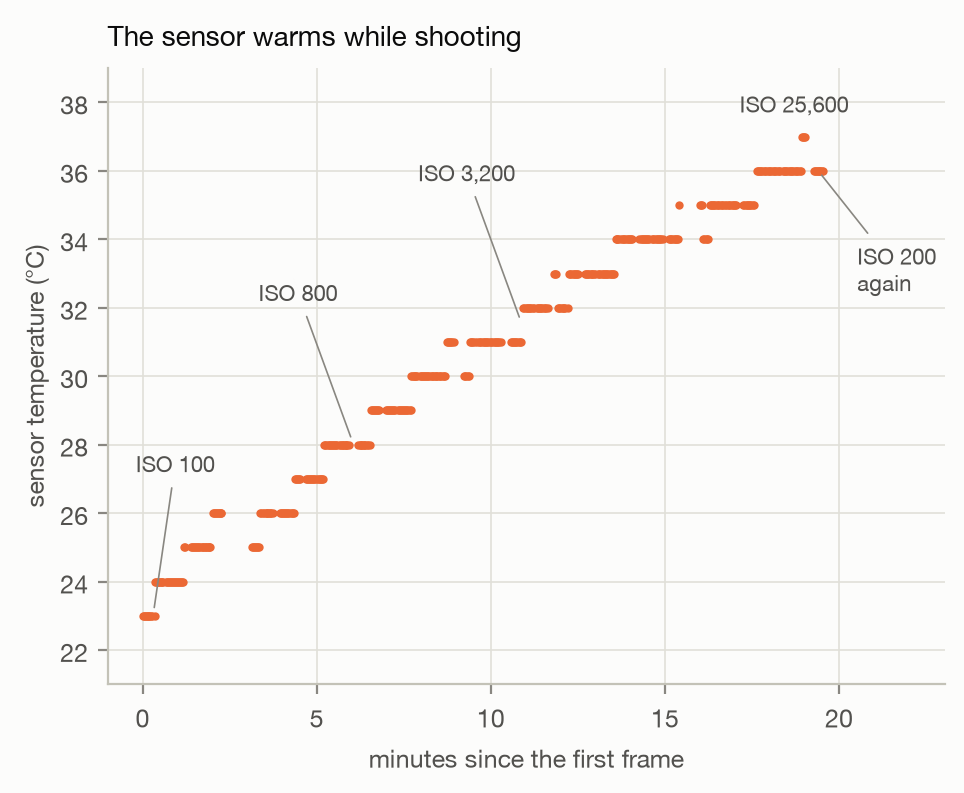
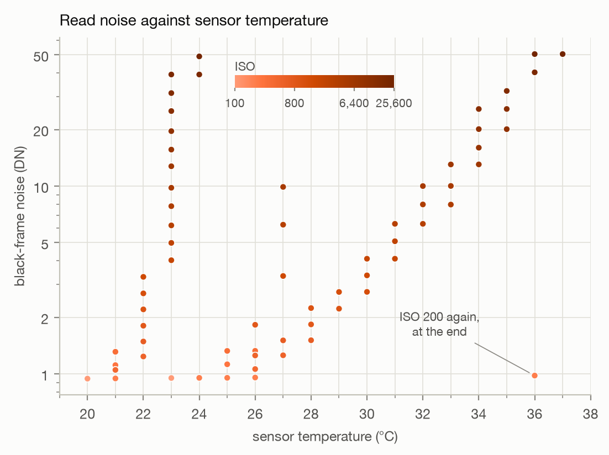
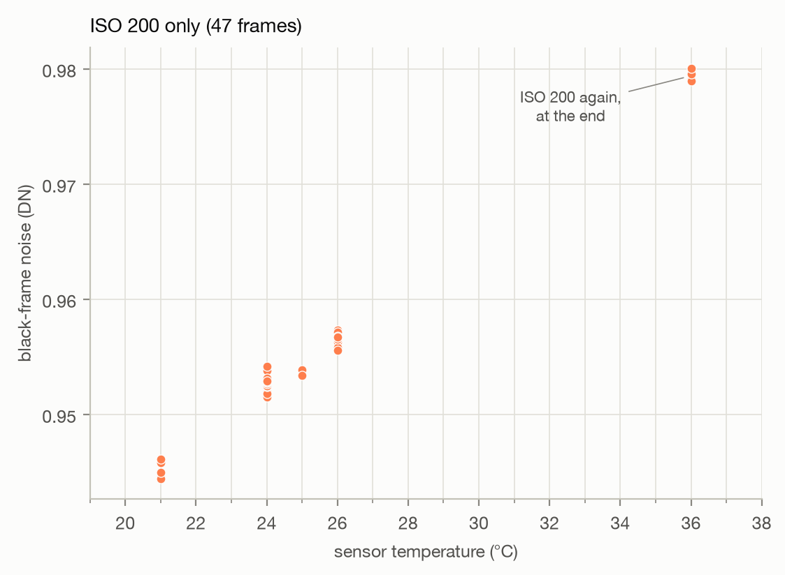
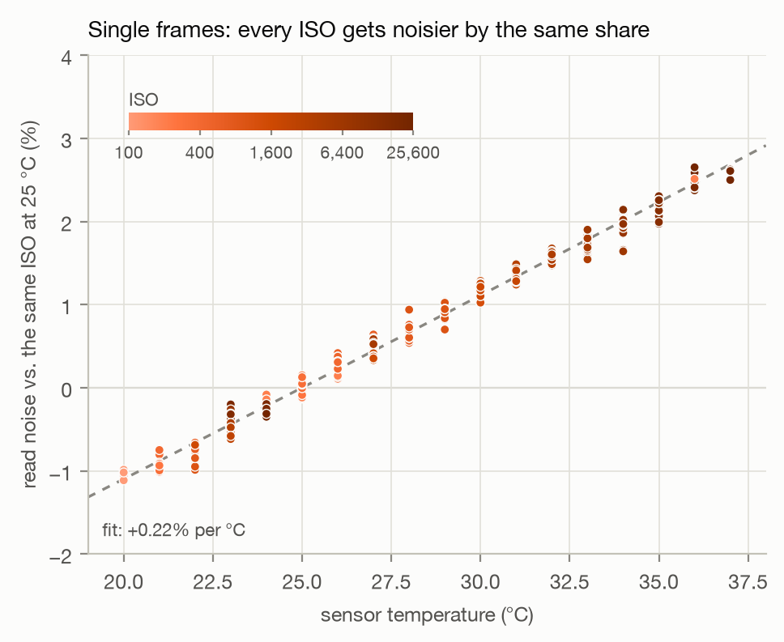
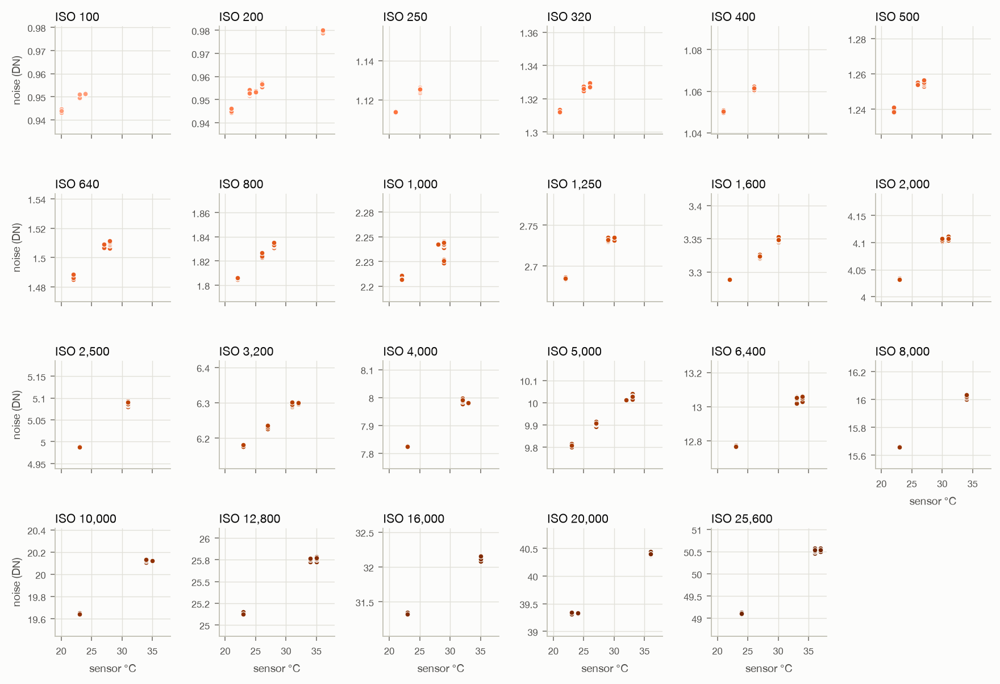

While shooting another dark frame set with my E-M10II ([previous post](https://pudelkom.github.io/2026/10/26/iso-invariance-em10ii.html)), I noticed that the camera got noticibly warmer over time, and wondered if that had any impact on noise. In astrophotography circles and scientific/industrial applications this is known issue after all [[1](https://www.cloudynights.com/forums/topic/760918-sensor-noise-vs-sensor-temperature-on-my-canon-dslr-a-fan-might-help/)][[2](https://www.dpreview.com/forums/threads/image-noise-sensor-temperature.3947759/)][[3](https://ieeexplore.ieee.org/document/5378403)].

I don't care enough to stick a temperature probe in there, but maybe there is somehting stored in the raws?

```bash
> exiftool -s -G1 -a "raw_data/e-m10 dark frames/PB060567.ORF" | grep -i temp
[Olympus]       WhiteBalanceTemperature         : Auto
[Olympus]       CameraTemperature               : 100
[Olympus]       SensorTemperature               : 23 23 0 C
```

Nice! I press X to doubt that `CameraTemperature` `100` is relevant, but `SensorTemperature` and `23 C` look very plausible. Let's see what we can do with that info:



We plot that `SensorTemperature` vs `DateTimeOriginal` (of the first frame) from that one continuous run I did last. 20 frames per ISO, for all ISO settings. That does take a while to shoot. Clear upwards trend over time and the 23C - 37C range seems realistic. The last 10 ISO 200 pics I did because I got this idea while shooting. And they will come in handy as we'll see next.

So we do know temperature goes up, but does that affect anything, and if, by how much?

What if we just plot the noise (that we know how to calculate from [before](https://pudelkom.github.io/2026/10/26/iso-invariance-em10ii.html#test-2-noise-vs-gain)) against the sensor temp?


Looks like there is *something* at first glance, but no. This is just a Noise vs ISO plot all over again. Look at the labeled ISO 200 point in the bottom right; high temps but still lower than most points. *But slightly higher than then other ISO 200 points?!* Maybe we do have something there, just need to normalize the data somehow.

Hmm, just to confirm plot only the ISO 200s I have most of anyway:



Okay, better. I ahvent seen any raw files with fractional C, so that quantization probably explains the slight spread at each C point. I'm also not shooting a single additional frame just to fill the gap, so we'll run with this. Looks linear enough :gigachad:

Alright, let's just do a least-squares fit over all this data. All in log scale as the absolute noise levels between ISOs differ so much, and we want to compare relatively based on temperature not ISO anyway. Math-lets cover your eyes for this one:

```python
import json, subprocess
from datetime import datetime
import numpy as np, rawpy

def temperature_slope(*folders):
    def frame(path):                     # all four color channels, borders cut off
        with rawpy.imread(path) as raw:
            return raw.raw_image_visible[64:-64, 64:-64].astype(float)

    def noise(x):                        # standard deviation without outliers
        med = np.median(x)
        mad = 1.4826 * np.median(np.abs(x - med))
        return x[np.abs(x - med) <= 5 * max(mad, 0.5)].std()

    info = json.loads(subprocess.run(["exiftool", "-j", "-ISO", "-SensorTemperature", "-ext", "ORF", *map(str, folders)],
                                     capture_output=True, text=True).stdout)
    points = []                          # (ISO, temperature, log of the noise)
    for i in info:
        v = frame(i["SourceFile"])
        n = np.mean([noise(v[a::2, b::2]) for a in (0, 1) for b in (0, 1)])
        points.append((i["ISO"], int(str(i["SensorTemperature"]).split()[0]), np.log(n)))

    isos = sorted({p[0] for p in points})
    x = np.array([[c] + [iso == k for k in isos] for iso, c, _ in points], dtype=float)
    coef = np.linalg.lstsq(x, [p[2] for p in points], rcond=None)[0]
    return coef[0], dict(zip(isos, coef[1:])), points


slope, levels, points = temperature_slope("raw_data/e-m10 dark frames", "raw_data/lens_cap")

for iso, temp, log_noise in points:
    at_25 = levels[iso] + 25 * slope           # this ISO's log noise at 25C
    y = 100 * np.expm1(log_noise - at_25)      # % above or below that
    plt.scatter(temp, y, c=[np.log2(iso)], vmin=np.log2(100), vmax=np.log2(25600))

t = np.linspace(19, 38)
plt.plot(t, 100 * np.expm1(slope * (t - 25)), "--")   # the fitted line, 0% at 25C
```



Looks like we nailed it! +0.22% noise in DN per C.

Now the all imporant question: **Is that a lot?**

Maybe?

For comparing between cameras or in actual photos (remember that these are all dark frames) this seems small: a 12C increase changes read noise by about 2.6%, or 0.03 stops of dynamic range on the E-M10II. *Probably nothing*. Any actual light input will dominate this. Then again, astro photography is basically dark frames.

But for analytically comparing ISO performance it might make a difference: that same 12C/2.6% noise difference might blur the lines on already small effects when there is no light involved.

Might be worth a try pushing this to the extremes. Same scene + tripod, camera straight from a freezer then letting it get toasty in the sun.

## Appendix

Noise vs temperature, split by ISO:

